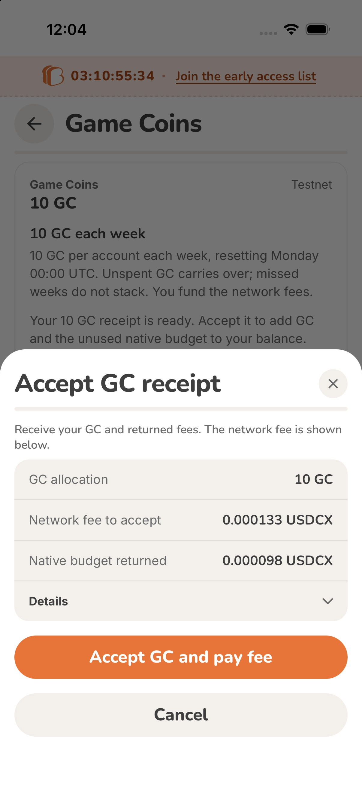
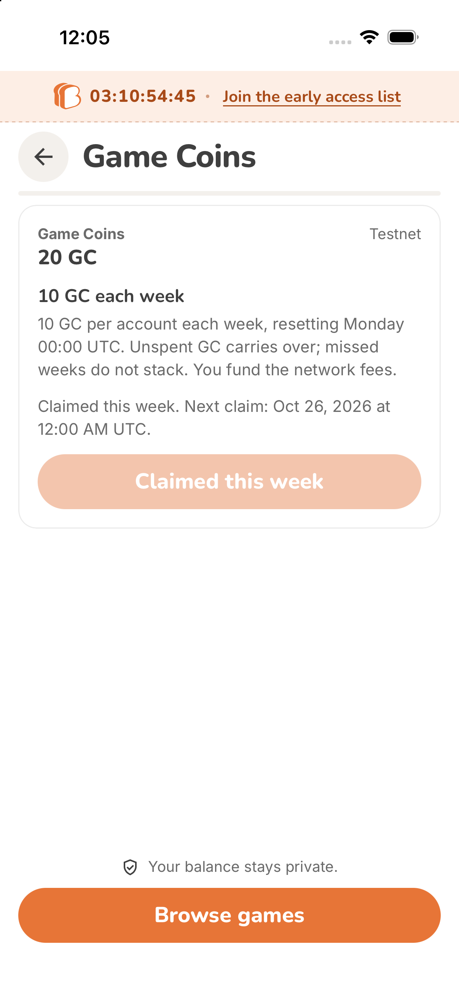
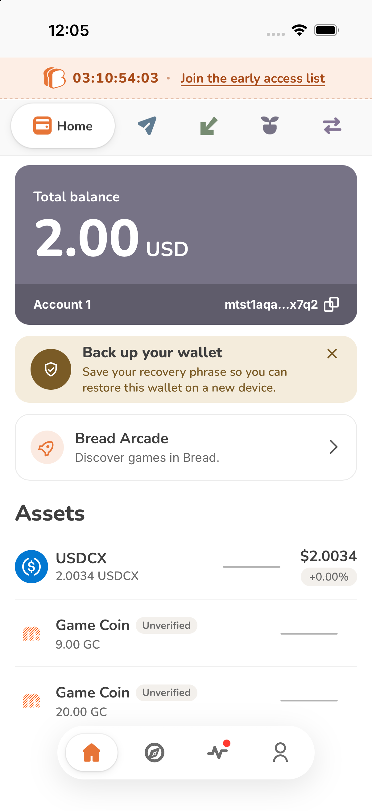
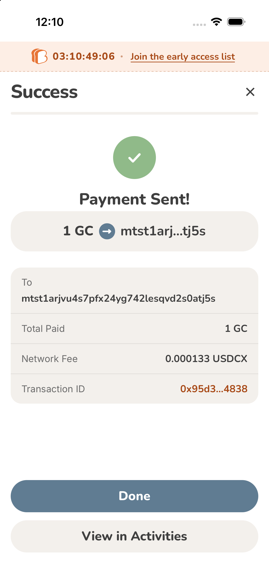

# Canonical GC wallet binding

The backend supports two independently scoped claim protocols. The approved Testnet asset is our existing
GC issuer `0x97924b9a77ed54917ff6d6364ae661`. The active Testnet distributor is
`0x5f2b2136d78f755114d00efe84b7aa`, committed at block 474315 with 10 GC of existing inventory.
It does not mint. Mainnet remains disabled.

The exact v1 binding is retained as cleanup-only configuration. Bread checks that history first and
keeps pending requests, receipts and refundable native budgets accessible before switching to new v2
claims. A prepared approval stays with its original backend even if cleanup finishes during review.
New v1 claims are disabled, including a race where recovery disappears during preparation.

A reviewed v2 deployment must provide `distribution.protocolVersion = 2`, `distributorId`,
`distributorCodeCommitment`, `gcFaucetId`, and the configured
`bread::gc::distributor::weekly_claims` map. The existing `issuerId` and
`issuerCodeCommitment` fields are legacy authority aliases: for v2 they must equal the distributor
ID and code. Conflicting aliases or incomplete v2 bindings are rejected. The GC faucet must differ
from both distributor and native asset.

Request routing, target attachment, foreign account input, receipt metadata sender, deployment code
and weekly entitlement map belong to the distributor. The allocation descriptor, receipt asset and
verified wallet GC balance use the canonical faucet. The v2 request retains 36 storage felts, sets
ABI version 2 at offset 29, distributor suffix/prefix at offsets 30/31, and receipt domain
`0x47435232`. Genesis, account, week, distributor, code, faucet and version remain bound throughout
quotes, persisted scope, recovery and receipt admission. A v1 quote cannot be reused with v2.

Canonical scopes have separate queue identities and retain their full distribution binding across
restart. Legacy scope keys are unchanged. An explicit deployment selects its GC faucet; this never relabels balances from a different issuer.
The chosen Testnet faucet is the same asset used in the existing trial; its v1 operations retain their
original protocol scope. This Testnet distributor starts a fresh weekly ledger; existing v1 allocations
are not copied into its map. Using the funded test account for both deployments tests protocol isolation,
not global weekly-history migration. A Mainnet migration requires a separate entitlement decision. Authenticated NoteFiles, Guardian fee-aware
builders, WASM locks, outgoing queue holds, duplicate prevention and uncertain-submit reconciliation
continue to use the ordinary wallet pipeline.

Run offline construction checks from the repository root:

```sh
node scripts/verify-gc-request.mjs
node scripts/verify-gc-distributor-request.mjs
```

These use the installed real Web SDK and the Rust fixture to compare note bytes, storage,
commitments, routing and serialized request output. They do not connect or write to a network.
The distributor fixture and its public seed are construction evidence only and must never become
a funding recipient or an active deployment. Live activation requires separately reviewed account
artifacts, roots, configuration and funding authorization. Token verification follows registry
publication; this change does not add a local verified badge override.

## Testnet deployment evidence

- Funding request `0x249ba374ba33f8995da5d28eb655b516f6e1643578f42dc9a671bf681888fc1c`: committed in block 474299, moving 10 GC and 210 native units into the bound bootstrap note. Sender fee 119 native units.
- Distributor creation `0x92d43b8fa378a433fbf99d784132313b5753761e05b79baa0e1a09a91fa3fc08`: committed in block 474315, inventory 10 GC, native reserve 0. Deposit fee 119 of 210; 91 returned in native-only P2ID receipt.
- Refund collection `0xca0ea22933135ec9db30b503d52716a2cc696f1875f1adc0e8e58a57e318cfad`: committed in block 474336, 91 received and 119 fee paid. Inventory remains 10 GC.

Deployment is confirmed separately from Bread native claim acceptance. Token-list PR4 remains a registry
publication dependency; the wallet does not grant a verified badge by overriding its token list. Game
repositories are read-only references. This change does not publish or modify any game.

## Native Bread acceptance

Validated on the preserved Bread GC Testnet Guardian account using this activation stack:

- Native weekly request `0x85c51751312d5addb71877c0de0b5a05a03a492a18b4bfbca372f463000583f7` committed in block 474488 and consumed by the distributor in block 474489.
- Receipt `0x13f74c57309492263986282ed0476b122e47f466ce98876923b18470f0041058` contains 10 GC and 98 native units, returning the unused portion of the 210-unit budget (112 execution fee). Bread explicitly reviewed a 133-unit receive fee, then consumed the receipt in block 474519.
- Balance increased from 10 GC to 20 GC. “Claimed this week” showed the next allowance at October 26, 2026 00:00 UTC. 20 GC remained after app termination/relaunch.
- A normal 1-GC public transfer to the other owned Testnet account committed in block 474627, note `0xe144152fc8ef6beb48b7e1d83eecdb3c5664f8aaf4b930c0c16957cd02f10991`; Bread confirmed 133 native units paid as its fee. The sender retains 19 GC. The recipient consumed that exact note in transaction
`0xc364b1e990f28a1897a2981e61cbd5a4eb65451f93142322bb6e3917a3a6de8b`, committed at block 474727; its balance increased from 0 to 1 GC and its receive fee was 119 native units. The separate 9-GC asset was not relabeled or spent.






Local checks: 146 Arcade tests, TypeScript, changed-file lint, real-SDK/Rust v1/v2 construction parity,
mobile/iOS build and extension background/UI builds passed. Native evidence is iOS-specific; extension
interactive claim acceptance and local Android are not established by these build checks. Android local
setup was explicitly skipped. CI retains the repository coverage threshold.

The initial 10-GC distributor inventory is exhausted by this acceptance claim. Further payouts require
replenishment using the protocol's funded deposit path; a fresh weekly ledger does not create token
supply. This is a deployment funding requirement, separate from the confirmed wallet flows above.
