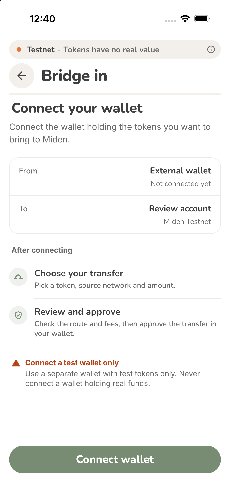
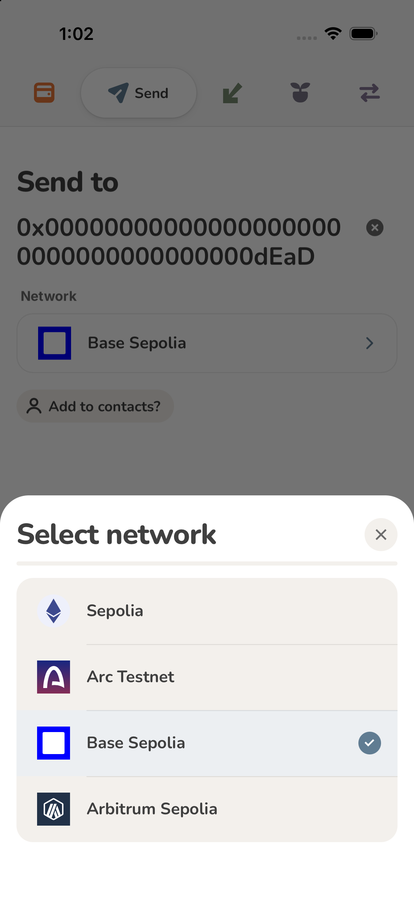
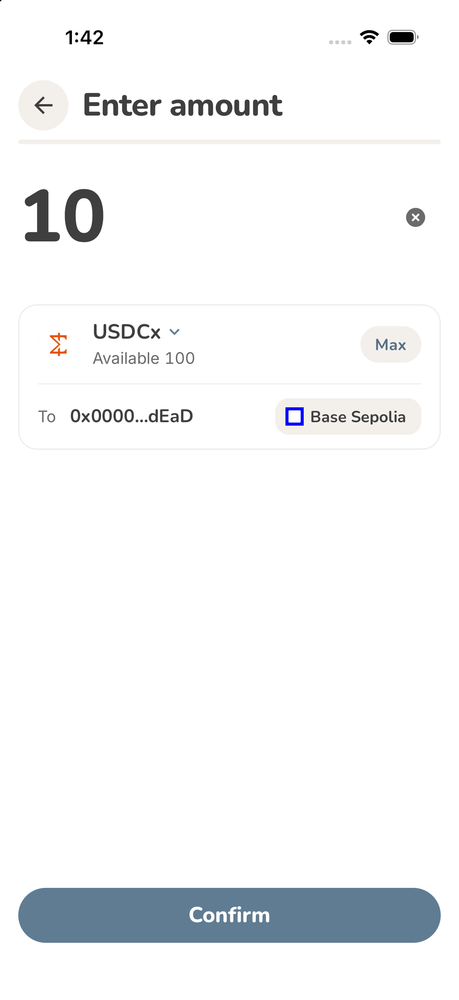
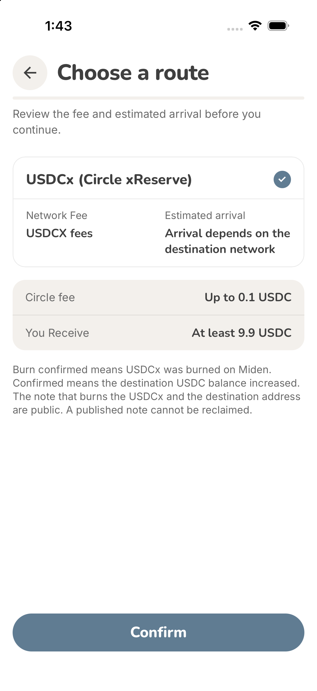
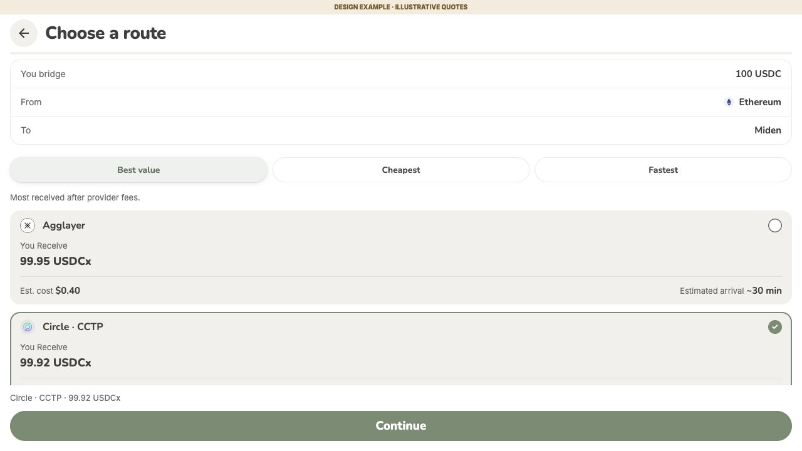
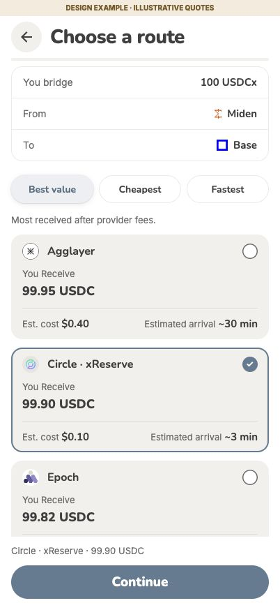

# Bridge UI review

## Implemented wallet UI

Captured from the dedicated iOS simulator using a public test account and display-only fixtures. No keys, signing, deposits, burns or payouts were used. The amount and route captures show the top home actions hidden from the amount step onward.

| Bridge-in connection | Destination network picker |
| --- | --- |
|  |  |

| Send amount | Current Send route |
| --- | --- |
|  |  |

## Ranked provider design examples

The reusable `BridgeRouteSelector` and ranking helper are implemented and tested. These screenshots render that component in a separate UI preview. Quotes, provider coverage and arrival estimates are illustrative. The component is not wired to live quote routing or transaction execution; existing supported routes remain in use. Provider marks in these preview captures are the public organization avatars used by the local preview.

| Receive example | Send example |
| --- | --- |
|  |  |

The interactive walkthrough remains a local review artifact and is not shipped as wallet runtime code.
