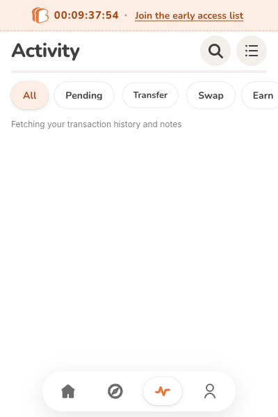
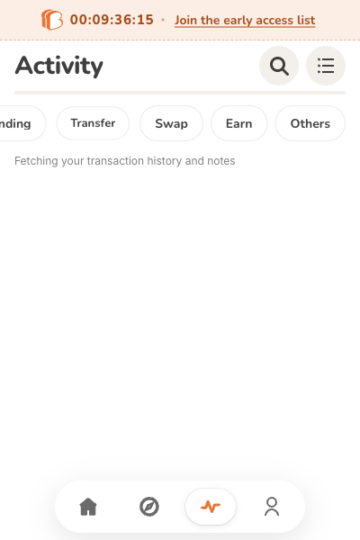

# Activity filter mouse dragging in Chrome

Captured with Google Chrome **155.0.8059.86** on the connected MacBook, using the real extension's `sidepanel.html#/history` at **400 × 600**. The original Slack screenshot (`F0CBX4ESGQ5`) was retrieved and inspected before selecting this component.

All five final acceptance scenarios explicitly assert `Target.getBrowserContexts` returns no off-the-record contexts and `chrome.extension.inIncognitoContext` is **false**. They run installed Google Chrome in a regular persistent test profile; the user's real profile is never opened. Earlier before/after captures used the same regular persistent-profile launch mechanism.

The current Activity List filters are **All / Pending / Transfer / Swap / Earn / Others**. Their shared scrolling row measures `scrollWidth=513`, `clientWidth=400`.

1. Open Activity in the extension side panel with All selected.
2. Press near the right of the filter row and drag left approximately 210 px, then release.
3. Before this change, `scrollLeft` remains **0**, leaving Others off screen. After this change it reaches the row's maximum, **113**, revealing Others. **All remains selected** in both images.

| Before | After |
| --- | --- |
|  |  |

These are synthetic frontend fixtures in fresh temporary regular Chrome profiles: mock client, empty backend, no vault creation, mnemonic access, signing or transaction requests. The feed's loading placeholder is intentional; transaction data is unnecessary for testing the actual filter control. Page requests outside loopback are blocked.

## Re-run

Install dependencies with `yarn install --frozen-lockfile`. In one terminal:

```sh
node scripts/feature-eligibility-fixture.mjs --port 18551 --networks testnet
```

Build the test-only extension:

```sh
MIDEN_E2E_TEST=true MIDEN_USE_MOCK_CLIENT=true \
MIDEN_E2E_DISABLE_SIDEPANEL=true MIDEN_NETWORK=testnet \
MIDEN_REMOTE_CONFIG_URL=http://127.0.0.1:18551 \
FEATURE_ELIGIBILITY_URL=http://127.0.0.1:18551/v1/eligibility \
MODE_ENV=development yarn build:chrome
```

Run the browser regression suite:

```sh
SKIP_EXTENSION_BUILD=true yarn playwright test --config playwright.activity.config.ts
```

All five scenarios pass in actual Chrome: bidirectional mouse dragging followed by clicks; keyboard selection, reveal and reduced motion; horizontal wheel and native touch scrolling; vertical wheel propagation; captured dragging and release outside the row followed by keyboard activation. This suite explicitly uses installed Google Chrome and runs separately from the generic Chromium smoke tests. The test's 60-second budget includes cold extension startup; interaction assertions retain the configured 10-second budget.

Unit regression was observed failing before the implementation (`scrollLeft`: expected 80, received 0). After implementation, the focused `SegmentedControl` and `AllHistory` suites pass **103 tests**. TypeScript, focused ESLint and the mock Chrome build pass.

Full lint on the base contains three unrelated `import/order` warnings in `src/lib/miden/back/main.test.ts:234`, `src/lib/miden/guardian/history.ts:20` and `src/lib/miden/swap/classification.ts:10`; those files remain unchanged. Native simulator acceptance is not claimed: this interaction is extension-only, and unit tests verify that non-extension and fill layouts do not acquire it.
